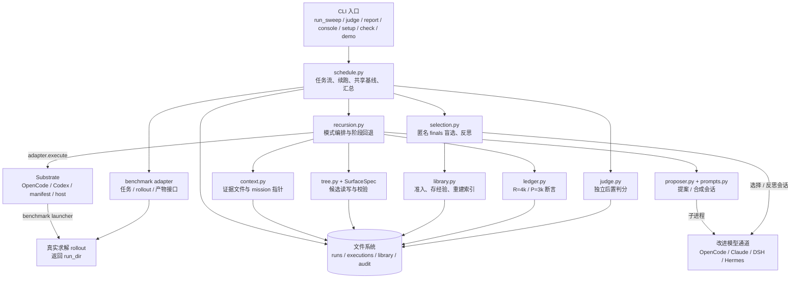
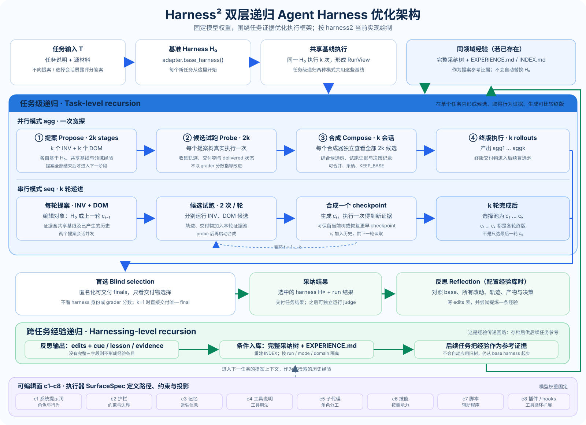
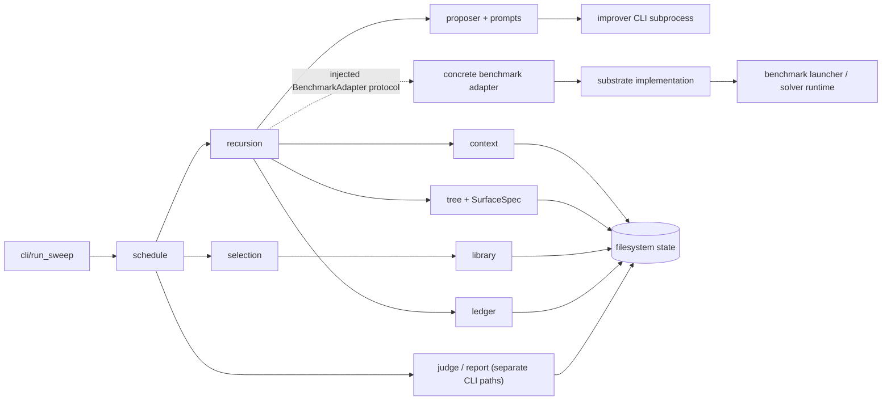
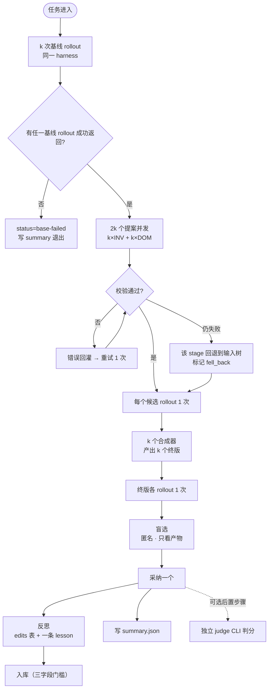
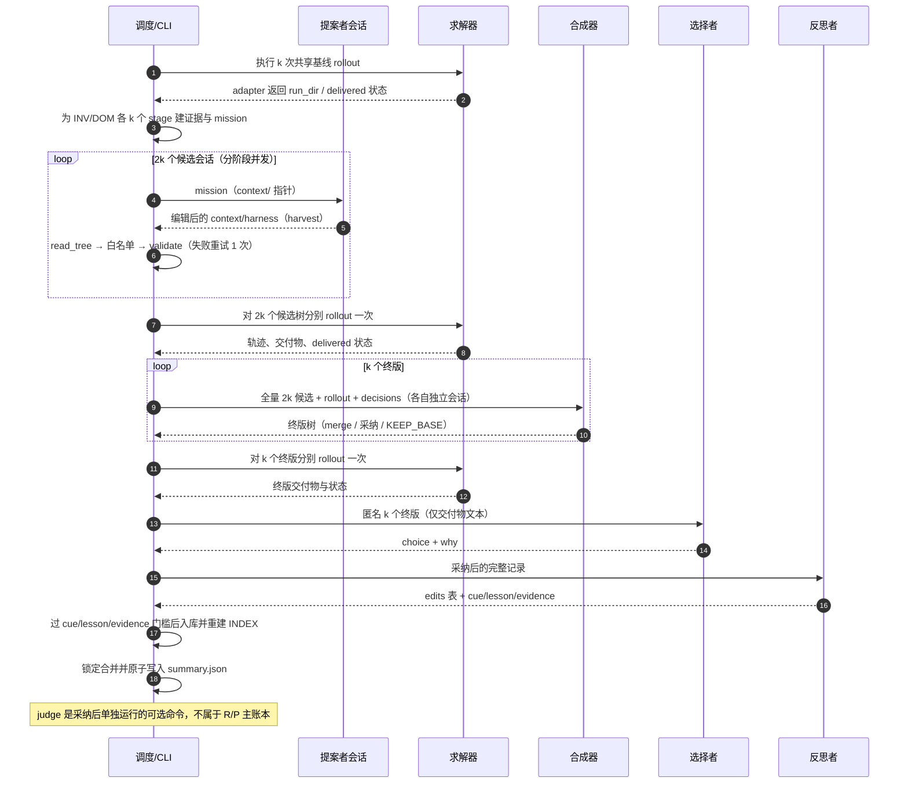
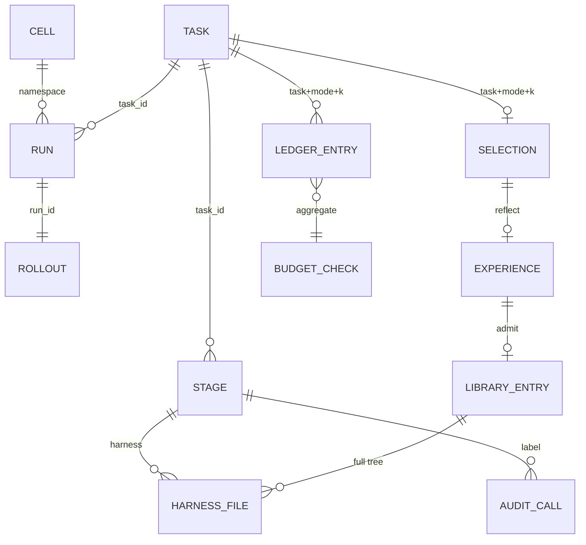

# Harness² 项目文档

> **版本**：v1 · 2026-10-23
> **配套产物**：[`PRODUCT-DESIGN.html`](PRODUCT-DESIGN.html)（产品设计 + 架构 + 时序 + 难题 + 界面原型）、[技术详解专题](technical/README.md)（9 篇代码级说明）、[`technical/index.html`](technical/index.html)（专题导航页）、[`prototype/`](prototype/)（7 个可单独打开的控制台原型页 + 单页前端实现 `prototype/app.html`）
> **代码位置**：`/home/malizhi/ai/harness2`（Python 43 模块 / 14,243 行，Apache-2.0）

---

## 0. 一句话

**Harness² 把 RSI（递归自我改进）从「改模型权重」挪到「改模型外面的那层系统」**：权重冻结，被优化的是 harness（系统提示词 / 护栏 / 记忆 / 工具说明 / 子代理 / 技能 / 脚本 / 插件），递归发生在**任务级**与**经验级**两层，学习信号是**同一任务上的行为对照**，不是分数。

---

## 1. 这是什么 / 不是什么

| 是 | 不是 |
|---|---|
| 一个批处理 CLI 框架（`harness2`、`harness2-judge`、`harness2-report`…） | 在线服务 / 多租户平台 |
| 三个专业基准的适配器（LAB / JobBench / WorkBuddy-Bench） | 一个通用 agent 产品 |
| 无凭证可跑的确定性 demo（`harness2-demo`） | 模型能力评测榜 |
| 文件式状态（`runs/` + `library/`），可 diff、可打包 | 带数据库的调度系统 |
| 内容与路径边界（白名单 / 绊线 / 盲选） | OS 级安全沙箱（见 §10） |

定位声明：上游是 Google 开源研究项目，README 明确「不是官方支持的 Google 产品」。本文档把它产品化地讲清楚，不构成 SLA 或安全承诺。

---

## 2. 5 分钟验证（不需要任何模型凭证）

```bash
cd /home/malizhi/ai/harness2
uv venv --python 3.12 .venv && source .venv/bin/activate
uv pip install -e '.[render]'
harness2-demo --output runs/demo --k 2
```

demo 用一个确定性编辑者走完整流程：基线脚本把贷记过滤掉了（`if amount > 0`），probe 后总分从 `105.25` 变成 `85.15`，选择器按源 CSV 核对后采纳，反思写出一条「求和要保留符号」的经验并入库。

想看流程与账本：

```bash
jq '.modes.agg.ledger' runs/demo/runs/demo-oc-agg2/ledger-1/summary.json
cat runs/demo/library/k2/agg/accounting/INDEX.md
```

---

## 3. 核心概念（中英对照）

| 概念 | 中文解释 | 代码中的作用 |
|---|---|---|
| Harness | 智能体运行框架层：提示词、护栏、记忆、工具说明、技能、子代理、脚本和插件；不包含模型权重 | `core/tree.py` 按执行器 `SurfaceSpec` 读写和校验可编辑文件 |
| RSI (Recursive Self-Improvement) | 递归自我改进；本项目改进模型外部的 harness，不训练模型权重 | 当前任务先形成候选，任务结束后把可迁移经验写入经验库 |
| Task-level recursion | 任务级递归：围绕单个任务提出改动、执行试跑、合成终版 | `core/recursion.py` 的 `run_parallel` / `run_sequential` |
| Harnessing-level recursion | Harness 经验递归：复盘候选、轨迹和决策，将经验用于后续任务 | `selection.reflect_adoption` 与 `library.add`；后续任务仍从 base harness 开始 |
| Propose–Probe–Compose | 提案—试跑—合成：提出改动，真实执行取得行为证据，再依据证据组合最终树 | 并行模式先做 2k 个 INV/DOM 提案与 probe，再生成 k 个终版；串行模式逐轮执行 |
| INV / DOM | 不变式维度 / 领域维度；前者针对跨任务通用做法，后者针对领域知识 | 两类提案使用不同 prompt，共享同任务基线证据 |
| Stage | 阶段：一次编辑提案及其收集、校验和记录过程 | `Stage` 在 `core/recursion.py`；rollout 是独立执行记录 |
| Rollout / Probe | rollout 是求解器真实跑一次任务；probe 是候选 harness 的试跑 | benchmark adapter 调用执行器并读取轨迹、交付物 |
| Compose / Aggregate | 合成：依据候选树、试跑证据和决策说明生成终版 harness | 并行 `AGG` 各自看全量候选；串行 `COMPOSE` 看本轮候选与历史 |
| Blind selection | 盲选：候选终版匿名后，只依据交付物选择 | `core/selection.py` 只收 finals、不收基线；k=1 直接选唯一终版 |
| Reflection / Experience | 反思 / 经验：复盘改动效果，提炼可迁移的 cue、lesson、evidence | 三字段非空才入库；反思失败不撤销已选结果 |
| Substrate / Channel | 执行器 / 会话通道；执行器运行求解 rollout，通道调用提案或选择模型 | `BenchSpec.channels` 与 `Substrate` 是独立配置轴 |
| Benchmark adapter | 基准适配器：将任务发现、启动、轨迹、交付物和判分接到统一接口 | `benchmarks/*.py` 实现 `BenchmarkAdapter` |
| Context / Evidence | 上下文 / 证据：磁盘文件树保存任务、源材料、轨迹、产物和候选 | `core/context.py` 构建；mission 提供文件指针 |
| Ledger (R/P) | 账本：按固定公式核对 rollout 数 R 和编辑阶段数 P | 每模式断言 R=4k、P=3k；选择、反思和重试不计入 |
| Namespace | 命名空间：由基准、执行器、模式、k、seed、tag 标识一组运行 | `core/schedule.py` 生成目录身份 |
| Resume / Fingerprint | 续跑 / 指纹：验证已有产物和 harness 身份；调用指纹复用相同会话结果 | `core/schedule.py` 校验 summary；`core/proposer.py` 缓存会话 |

## 4. 总体架构（按实际调用方向）



真实主链是 CLI → schedule → recursion；recursion 通过 adapter/substrate 执行 rollout，通过 proposer 驱动编辑会话。selection 和 library 在递归之后处理采纳与经验。judge 是另一个 CLI 命令，选择后独立执行，并非递归流程中的必经子进程。系统没有服务端或数据库，目录、JSON 和审计文件是持久状态。



---

## 5. 模块架构与逐模块运作



三条不可逆的依赖方向：

1. **core 不知道具体基准**（只面向 `BenchSpec` / `BenchmarkAdapter`）；
2. **core 不知道具体执行器**（只面向 `SurfaceSpec` + `Substrate`）；
3. **证据只从适配器来**（不扫目录猜产物）。

运行时，`schedule` 把 adapter 注入递归器；递归器只通过 adapter 接口请求 rollout。adapter 内部再调用 substrate 和 benchmark launcher。judge/report 是独立 CLI 路径；Proposer 子进程与 solver 子进程也各有不同职责。

| 模块 | 如何运作 | 输入 → 输出 |
|---|---|---|
| `cli/run_sweep.py` | 解析参数、配置通道和 adapter，调用 `schedule.run_sweep` | 参数 → namespace、summary |
| `core/schedule.py` | 排任务；检查续跑；共享基线；调用递归模式；锁定合并 summary | task stream → task result、落盘记录 |
| `core/recursion.py` | 并行模式分阶段提案/试跑/合成；串行模式逐轮更新 checkpoint；校验失败回退 | 基线 + harness → stages、finals、ledger |
| `core/context.py` | 从 adapter 读取任务、源文件、产物和轨迹，写证据目录并检查泄漏标记 | adapter 证据 → context tree、mission |
| `core/proposer.py` | 算指纹；命中缓存则复用，否则启动会话 CLI；harvest 改动并写审计 | mission/context → Reply、编辑树 |
| `core/tree.py` | 按 surface 读写树，拒绝越界路径，执行通用及基准校验 | 文件树 → Tree 或错误 |
| `core/selection.py` | 过滤不可交付结果、匿名化 finals；采纳后生成反思记录 | final RunView → selection/reflection |
| `core/library.py` | 检查 cue/lesson/evidence，保存采纳树与经验并重建索引 | adopted tree + experience → 领域库 |
| `core/ledger.py` | 汇总阶段与 rollout 数量并断言预算 | labels → ledger 或 `BudgetError` |
| `core/spec.py` | 定义 benchmark、adapter、substrate、channel 的接口契约 | 配置值 → 运行时接口 |
| `substrate/*` | 投影 harness、组装 argv/env、执行并统一渲染轨迹 | tree + RunRequest → run_dir、trajectory |
| `benchmarks/*` | 发现任务、构造 launcher、抽取交付物和判分，判断是否交付 | task + substrate → rollout 数据 |
| `core/judge.py` / `cli/judge.py` | 主实验后独立读取选中结果、调用 scorer，保留 unscored 状态 | chosen run → judged JSON |
| `core/report.py` / `cli/report.py` | 汇总 summary 与 judged 结果，不执行任务 | run 文件 → 报告 |

---

## 6. 一次任务的流程（并行模式）



串行模式每轮由两个提案（INV、DOM）并发开始，候选分别 probe 后合成一个 checkpoint；下一轮以该 checkpoint 为编辑对象，并读取历史 rollout。k 轮含 2k 个候选 rollout 和 k 个 checkpoint rollout。选择池是 `c1..ck` 终版，不含基线。

---

## 7. 核心时序



---

## 7. 数据模型（逻辑表 → 物理落地）

没有数据库；下表是查询视角，`ER` 在 [PRODUCT-DESIGN.html §3.7](PRODUCT-DESIGN.html#s3-7)。



| 逻辑表 | 主键 | 物理位置 |
|---|---|---|
| `cell` | `(bench, substrate, mode, k, seed, tag)` | namespace 字符串 |
| `task` | `task_id` | `runs/<ns>/<task>/task.md` + `context/source/` |
| `run` | `run_id` | `executions/<ns>/<task>/<label>/` |
| `stage` | `(task, mode, k, label)` | `summary.modes[].stages[]` + `harnesses/<label>/` |
| `rollout` | `label`（1:1 run） | `context/rollouts/<label>.md` + 执行目录 |
| `selection` | `(task, mode, k)` | `selection/<mode><k>/selection.json` + `summary.selections[]` |
| `experience` | `(task, mode, k)` | `summary.selections[].experience` + `reflection/` |
| `library_entry` | `(bench, mode, k, domain, task)` | `library/<bench>/k<k>/<mode>/<domain>/harnesses/<task>/` |
| `harness_file` | `(harness_id, rel)` | `harnesses/<label>/<rel>` · `context/harness/<rel>` |
| `ledger_entry` | `(task, mode, k, seq)` | `summary.modes[].ledger.entries[]` |
| `budget_check` | `(task, mode, k)` | `summary.modes[].ledger`（R/P/expected） |
| `audit_call` | `(label, fingerprint)` | `<audit>/<label>.<fp>.{mission,system,response}.md + .meta.json + .workspace/` |

一致性：**没有外键、没有事务**；靠「先写临时文件再 `os.replace`」「flock 合并写 summary」「INDEX 从磁盘重建」。

---

## 8. 关键机制

### 8.1 可编辑面（c1–c8）

| 组件 | OpenCode | Codex | 常驻？ |
|---|---|---|---|
| c1 系统提示词 | `systemprompt.md` | `AGENTS.md` | 是 |
| c2 护栏 | `guardrails.md` | `AGENTS.md` | 是 |
| c3 记忆 | `LongTermMEMORY.md` | `AGENTS.md` | 是 |
| c4 工具说明 | `tool_descriptions/tool_guidance.md` | `AGENTS.md` | 是 |
| c5 子代理 | `sub_agents/<name>/AGENT.md` | 同左 | 否 |
| c6 技能 | `skills/<name>/SKILL.md` | `.agents/skills/<name>/SKILL.md` | 否 |
| c7 脚本 | `scripts/*.py` | 同左 | 否 |
| c8 插件/hooks | `plugin/*.ts` | `.codex/hooks.json` | 工具循环内 |

常驻上限：OpenCode **24,000** 字符；Codex **8,000** 字符（Codex 自身还会在 32,768 字节截断）。超限 → 校验失败。

编辑契约：**省略即继承**；越界文件 → **整棵提案作废**（不是静默丢弃），错误原文回灌、重试一次。

### 8.2 证据协议

- 证据是文件：`context/{task.md,source,rollouts,deliverables,harness,library,pool,decisions}`；
- prompt 只有指针（`MISSION.md`），轨迹不按 prompt 预算截断；
- 产物用**判分器同款读取器**渲染；
- 三道路障：`leak_globs`（答案键路径）、7 个 grader 标记绊线、`RunView` 不带分数；
- 证据是数据不是指令：明确禁止执行候选 harness 里的脚本。

### 8.3 预算与账本

`R = 4k`（k 基线 + 2k 候选 + k 终版），`P = 3k`（INV + DOM + 合成）；`ledger.assert_identity()` 对不上即 `BudgetError`。选择与反思不计入 R/P。

### 8.4 选择与反思

- 选择池**只含 finals**（基线不入池）；k=1 跳过选择会话；选择失败时回退到排序后的第一个 final（不是基线）；
- 反思产出一张 `edits` 表（`helped|hurt|no observed effect|confounded`）+ 至多一条经验；
- 经验入库门槛：`cue` / `lesson` / `evidence` 三字段非空，缺一不入库。

### 8.5 经验库

按 `bench × mode × k × domain` 隔离；条目 = 完整被采纳树 + `EXPERIENCE.md`；`INDEX.md` 每次从磁盘重建。**下一个任务仍从 base harness 起步**，库只作为证据。

### 8.6 续跑与缓存

调用指纹 = `sha256(label, mission, system, 证据路径 + 每个文件字节)[:16]`；命中 → `usd=0`、`cached=True`。任务续跑还校验 chosen run 目录、产物可重读、`harness_fingerprint` 一致；任一不符 → 重跑该任务。

---

## 9. CLI 与配置

| 命令 | 作用 |
|---|---|
| `harness2 --bench lab --k 1 --mode parallel` | 跑递归（可 `--dry-run`） |
| `harness2-judge --bench lab --k 1 --mode parallel` | 采纳后判分（`--bases` 给基线打分） |
| `harness2-report --bench lab --k 1 --mode parallel` | 汇总结果 |
| `harness2-setup lab` | 安装基准与依赖 |
| `harness2-check --bench lab` | 预检 |
| `harness2-demo --output runs/demo --k 2` | 无凭证 demo |
| `harness2-bridge` | 本地模型代理（可选） |

关键参数：`--bench` `--k` `--mode` `--substrate oc|cx` `--workers` `--seed` `--only-domains` `--max-tasks`（**每域**上限）`--dry-run` `--split-file`。

关键环境变量：`HARNESS2_RUNS_DIR`、`HARNESS2_SOLVER_MODEL`、`HARNESS2_IMPROVER_MODEL`、`HARNESS2_CODEX_BASE_URL` / `_API_KEY`、`HARNESS2_JUDGE_MODEL`。

**run / judge / report 必须同 bench、executor、subset、k、mode、seed。**

---

## 10. 已知限制（与 PRODUCT-DESIGN §7 对应）

| # | 限制 | 影响 | 最小加固 |
|---|---|---|---|
| 1 | 候选只 probe 1 次（n=1） | 因果判定弱 | top-1 候选 n=2 重复 |
| 2 | 循环内无留出验证 | 过拟合只能事后发现 | test 集固定，只评估不进库 |
| 3 | 组件数量/体积无上限 | 树与库膨胀、上下文变贵 | `validate_tree` 加体积/数量上限 |
| 4 | 脚本/插件/hooks 无内容审查 | 任意代码随执行器权限运行 | import 白名单 + hooks 审核 |
| 5 | 执行器网络不限 | 可下载公开 rubric | egress 白名单 |
| 6 | 改进/选择/判分可同源 | 自我偏好 | judge 换独立模型 |
| 7 | 选择与反思不计入 R/P | 真实成本被低估 | 纳入账本 + token 预算 |
| 8 | 无 OS 沙箱（Codex 关闭） | 多租户不可直接暴露 | 容器 + 只读挂载 |
| 9 | 测试仅 229 行 | 回归风险 | 补 workflow / 校验器测试 |
| 10 | k=1 无跨候选比较 | 单步结论更弱 | 池中加匿名基线做 A/B |
| 11 | dsh/hermes 只跑 local 基准 | 三个专业基准仍需原生 launcher | 按基准实现 launcher（见 docs/SUBSTRATES.md） |
| 12 | dsh/hermes 轨迹是文本 stdout | 看不到工具级动作 | 接 DSH 会话 JSONL / Hermes ShareGPT 渲染 |

---

## 11. 代码地图

| 文件 | 职责 |
|---|---|
| `core/schedule.py` | 命名空间、任务流、单任务/域/sweep、续跑、summary 合并 |
| `core/recursion.py` | 两种模式的阶段编排与失败回退 |
| `core/context.py` | 证据树、mission、泄漏与 verdict 绊线 |
| `core/tree.py` | c1–c8 读写、校验、diff、多样性 |
| `core/proposer.py` | 改进者会话、超时重试、harvest、审计、指纹缓存 |
| `core/selection.py` | 候选清洗、匿名、盲选、反思、经验提炼 |
| `core/library.py` | 领域库：入库、索引、检索 |
| `core/prompts.py` | 全部作业文本（INV/DOM/合成/选择/反思） |
| `core/ledger.py` | 预算恒等式 |
| `core/spec.py` | 基准/执行器/通道抽象 |
| `substrate/opencode.py` | OpenCode 投影、三种安装模式、事件流渲染 |
| `substrate/codex.py` | Codex 投影、codex_root 安装、exec 参数、thread-item 渲染 |
| `substrate/manifest.py` | 声明式 substrate：SurfaceSpec/安装/exec/轨迹 + GenericSubstrate |
| `substrate/registry.py` | 名称 → Substrate；内置 + manifest 发现 + 别名 |
| `substrate/host.py` | 通用 host rollout：workspace + 任务文件 + CLI + 产物快照 |
| `substrate/manifests/{dsh,hermes}.json` | DSH / Hermes 的真实可编辑面与调用契约 |
| `benchmarks/local.py` | 任意目录任务 × 任意 manifest substrate（check.sh 判定） |
| `benchmarks/*.py` | 三基准：任务发现、执行、轨迹/产物、判分 |

---

## 12. 术语

见 [PRODUCT-DESIGN.html §8](PRODUCT-DESIGN.html#s8)。

---

## 13. 文档与原型清单

| 文件 | 内容 |
|---|---|
| `PRODUCT-DESIGN.html` | 产品设计（10 章）：定位、概念、架构、模块图、技术方案、数据模型、ER、时序、指南、7 页原型、10 个难题、术语、FAQ |
| `PROJECT-DOC.md` | 本文档：快速开始、架构、流程、时序、ER、机制、限制、代码地图 |
| `architecture.svg` | 双层递归概念架构图：并行/串行任务级递归、盲选、反思入库与跨任务经验回路 |
| `technical/` | 9 篇专题：架构、算法、stage/证据、selection/library、适配器、状态/预算、信息安全、CLI 运维、可编辑面校验 |
| `prototype/workbench.html` | 总览：run 身份、领域矩阵、异常事件 |
| `prototype/run.html` | 单任务：基线 / 阶段 / 采纳 / 反思 |
| `prototype/pipeline.html` | Propose–Probe–Compose 四列 + diff 抽屉 |
| `prototype/evidence.html` | 证据树 + 内容 + 纪律 |
| `prototype/library.html` | 领域库：INDEX / EXPERIENCE / 门槛 / 空态 |
| `prototype/ledger.html` | 账本：恒等式、规模换算、指纹 |
| `prototype/report.html` | 报告：base vs refined、判分口径、复现 |
| `prototype/app.html` | **单页前端实现**：9 个视图（含实时活动、配置与状态）+ hash 路由 + 真实筛选/导出/抽屉/四态/快捷键（自包含、零外链；开服务时读真实数据） |
| `harness2/console_data.py` + `harness2-console` | 把真实 runs 树（summary/ledger/library/executions/judged）映射成控制台模型；只读服务或 `--export` 快照 |
| `harness2/console_activity.py` | “此刻在干什么”：`/proc` 进程 + 窗口内产物写入 + 由产物推断的阶段（`GET /api/activity`） |
| `prototype/assets/` | 设计令牌与外壳（复用同机参考文档的工业暗色系统） |
| `prototype/README.md` | 静态原型页与单页实现的关系、打开方式、数据口径、改动指引 |
| `../SUBSTRATES.md` | 执行器接入：OpenCode / Codex / DSH / Hermes / Qwen Code / WorkBuddy / Claude Code / 自定义 manifest / local 基准 |

---

## 附录 A · 实测数字（2026-10-23）

- Python：43 模块 / 14,142 行（core 14 / 5,897；substrate 7 / 1,925；benchmarks 8 / 4,431；cli 9 / 1,121）
- 测试：2 文件 / 650 行（含 substrate + local 端到端）
- CLI 入口：7 个
- 可编辑组件：8 个；基准：3 个；安装模式：4 种
- 预算：每任务 4k rollouts / 3k 编辑会话
- 常驻上限：OpenCode 24,000 / Codex 8,000 字符；Codex 版本 0.144.6
- demo 运行：`runs/demo`（ledger-1 / ledger-2，k=2，agg + seq，R=8 / P=6）

## 附录 B · 本文档的验证方式

- 原型页均通过 headless Chromium `--dump-dom` 冒烟（脚本注入、外部资源为零）；
- 文档内所有 iframe / CSS / JS 均为相对路径本地文件；
- 演示数字的来源在正文中逐处标注（demo 产物 / README 口径 / 演示占位）。

## 附录 C · 许可

代码 Apache-2.0；文档与原型随仓库分发。上游声明「不是官方支持的 Google 产品」。
