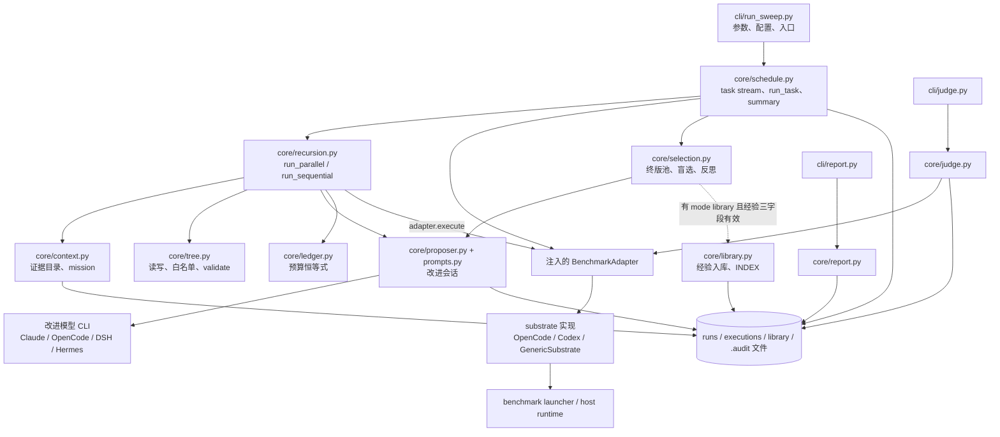

# 01 · 系统架构与代码边界

[返回技术详解索引](README.md) · [总架构 SVG](../architecture.svg)

## 这套系统是什么

Harness² 是一个本地批处理实验工具。执行入口是 Python CLI；任务、harness 快照、轨迹、产物、summary、审计和经验库存为文件。它没有常驻 API 服务，也没有数据库。一次求解会调用 benchmark 提供的 launcher，launcher 再调用具体 agent runtime；改进会话则由独立的 proposer channel 子进程承载。

它把“改进方法”“要跑的任务”“agent 框架”“模型访问通道”分开，避免每增加一个 benchmark 或 runtime 就复制一份递归算法。

## 真实调用图

图中的“注入”是实际边界：`core` 通过 `BenchmarkAdapter` 调用任务能力；它不按 benchmark 名称分支，也不负责拼具体的 runtime 启动命令。adapter 持有 substrate 并实现任务专属的执行和产物读取。

## 各层负责什么

| 层 / 代码 | 如何工作 | 解决的问题 | 明确边界 |
|---|---|---|---|
| `harness2/cli/*` | 解析参数、创建 adapter/Proposer、调用 core；judge/report 是独立入口 | 用户操作与算法逻辑分开 | CLI 不保存任务状态在内存以外；状态落盘 |
| `core/schedule.py` | 确定 task stream、namespace、续跑；每任务基线后调用模式；合并各模式 summary | sweep 顺序、复现身份、错误隔离 | 同域任务串行；不同域可线程并发 |
| `core/recursion.py` | 并行或串行地创建 Stage、rollout、终版；失败回退到输入 harness | 在相同任务证据下产生可比较候选 | 不读取最终 grader 分数指导改进 |
| `core/context.py` | 通过 adapter 读取任务、源材料、轨迹和产物并写证据目录 | 长证据不塞进模型 prompt；统一证据形状 | 读取授权仍由 adapter 实现，代码中的绊线是内容检查，不是操作系统沙箱 |
| `core/tree.py` | 依据 `SurfaceSpec` 识别组件路径，读写与校验 harness Tree | 给模型有限、明确的可编辑面 | 各 substrate 的 surface 不同，不能假设所有组件都可用 |
| `core/proposer.py` / `core/prompts.py` | 组装单次改进会话、调用模型 CLI、回收 workspace、落审计 | 把“模型会话协议”与递归控制分开 | selector/reflector 也通过 proposer 调用，但其预算独立于 P |
| `core/selection.py` | 构造 finals-only 池、匿名化、选择、反思 | 选择不依赖 harness 标签或 score | k=1 不调用选择模型；分数不能在此被选取 |
| `core/library.py` | 按 domain 管理采纳树、经验文档和索引 | 让跨任务知识可浏览/可被新提案引用 | 不会自动将旧树应用到新任务 |
| `core/spec.py` | 定义 `BenchSpec`、`BenchPrompts`、`ChannelSpec`、协议和 `RunView` | 让方法、任务、模型访问设置正交 | Protocol 约束形状，不会自动提供安全隔离 |
| `substrate/*` | 投影 harness 文件、创建执行参数、读运行轨迹 | runtime 的目录结构/事件格式差异收敛 | 子进程真正可做什么仍由其权限决定 |
| `benchmarks/*` | 任务发现、launcher、trajectory/artifact extractor、score | benchmark 专属行为集中在适配器 | benchmark 自身状态格式并不统一 |

## 三个独立配置轴与一个方法轴

`core/spec.py` 的设计把以下值分开：

| 轴 | 类型 / 代码 | 示例 | 回答的问题 |
|---|---|---|---|
| 方法 | `mode` + `k` | `agg, k=2` / `seq, k=2` | 怎么生成候选和终版？ |
| Benchmark | `BenchSpec` + adapter | LAB、JobBench、WorkBuddy、local | 任务是什么，怎么运行和读取交付物？ |
| Substrate | `Substrate` / `SubstrateLike` | OpenCode、Codex、manifest substrate | harness 怎么装入 agent runtime，怎么启动/读轨迹？ |
| Channel | `ChannelSpec` | claude_cli、opencode、dsh_cli、hermes_cli | 提案/选择模型会话如何启动？ |

有些 adapter 支持多个 substrate；这并不意味着任何 benchmark × substrate 组合都已实现。可用组合由 `spec_for(...)` 和 adapter/launcher 决定。

## 依赖边界为什么这样设计

1. **递归方法不含 benchmark 分支。** `BenchmarkAdapter` 提供任务、轨迹、交付物、执行和 `validate_tree`；新 benchmark 主要在 `benchmarks/` 实现这些动作。
2. **harness 形状由 surface 描述。** `SurfaceSpec` 说哪些路径属于 c1–c8、常驻文本上限、hook/skill 规则；OpenCode/Codex 的物理投影不同。
3. **改进通道和求解 substrate 不要混为一谈。** proposer CLI 产出编辑，solver runtime 执行 benchmark；二者可以是不同模型和不同程序。
4. **判分保持在独立后置命令。** `core/judge.py` 只被 `cli/judge.py` 调用，selection 的 `RunView` 不带分数。

## 并发在哪里

- `run_sweep(..., domain_parallel=N)` 可并发跑不同 domain。
- `run_domain` 对该域的 task 按 stream 顺序串行跑，使前序经验可供后续 task 读取。
- recursion 内部的 proposal 和 rollout 各自在一个 phase pool 中并发；phase 之间有等待屏障。
- WorkBuddy adapter 可能将多个 trial 放进 Harbor batch；它仍提供每个 harness/run 身份对应的结果。

线程池只并发本地调度；模型与求解调用本身通常是子进程。具体宽度由 `config.PHASE_WIDTH` 等设置决定，不能从“并发”推出固定并行度。

## Task stream 的顺序算法

`schedule.task_stream` 先按 adapter 的 `domain_of` 分组，再应用 split、only-domains、only-tasks、max-tasks 过滤，最后由 `stream_order` 产生唯一任务流：

- `seed=None`：按 adapter 提供的 frozen domain order；单 domain 内 task id 排序。
- 给定 seed：先从排序后的 domain 列表用 `Random(f"{seed}:__domains__")` shuffle；每个 domain 的 task id 也先排序，再由独立的 `Random(f"{seed}:{domain}")` shuffle。
- 每个 domain 的 shuffle 只依赖 `(seed, domain, task set)`；删掉一个 domain 不会改变其他 domain 内 task 顺序。
- `run_domain` 按该顺序一个接一个执行任务；不同 domain 的线程完成顺序不改变各自 task stream。

这套顺序服务于可复现的 continual-learning 实验：任务 t 只应看到此前 task 的经验。Seed 只确定任务顺序和 namespace，不控制远程模型采样、solver 的非确定性或外部数据变化。

## 代码入口

- `harness2/cli/run_sweep.py`: `_main` → `schedule.run_sweep`
- `harness2/core/schedule.py`: `run_sweep` → `run_domain` → `run_task` → `_run_one_mode`
- `harness2/core/recursion.py`: `run_mode` → `run_parallel` / `run_sequential`
- `harness2/core/spec.py`: protocol 与值对象
- `harness2/substrate/registry.py`: substrate 名称解析与发现
- `harness2/benchmarks/*`: 具体 adapter

继续阅读：[递归算法](02-recursion-algorithms.md) · [执行适配](05-adapters-substrates-channels.md) · [CLI](08-cli-runbook.md)
