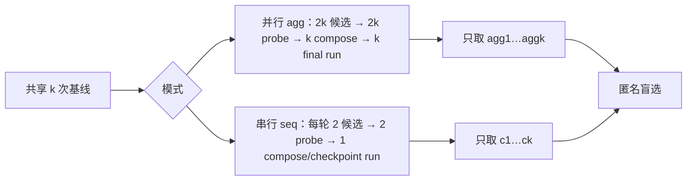
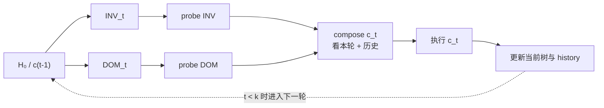

# 02 · 任务递归算法：并行宽探与串行递进

[返回索引](README.md) · [系统架构](01-architecture.md) · [单次 Stage](03-stage-context-proposer.md)

## 目标与信号

一次任务有一份原始任务、源材料和基线 harness。算法在不读取 grader 分数的情况下，提出 harness 修改，让求解器在**同一任务**运行候选，并把轨迹与交付物当作行为证据。所谓“递归”发生在任务内部的候选更新，以及任务结束后的经验归纳；不是反复训练模型权重。

共同前提：`schedule.run_task` 执行 k 个共享基线 `base1..basek`，把同一组 `RunView` 传给每个所请求模式。若没有任何 `RunView.ok`，任务记录 `base-failed` 并提前结束。这里 `ok` 表示 rollout 目录/执行返回有效；它与 `delivered`（是否产出可交付结果）是不同字段。



## 并行模式 `agg`：宽探

实现：`core/recursion.py::run_parallel`，单 stage 执行器是 `_run_stage`。

### 算法步骤

1. **固定输入。** 把 base tree 写到 `harnesses/base`；同一个基线 rollout 列表用于所有提案。
2. **生成 2k 个 stage。** `specs = [(inv1, INV), (dom1, DOM), …]`。每个 Stage 有自己 label、mission/context、会话和 retry；所有候选回退树都是 `base_tree`。
3. **提案 phase 完成后统一 probe。** 把每个 Stage 的 tree 传入 `_roll_many`。每棵候选树执行一次，拿到 `RunView`。并发结果随后按输入顺序记账。
4. **收集全量候选证据。** `pool_ev` 保存 label、harness 目录、rollout；还收集每个提案器返回的 decisions/notes。
5. **运行 k 个独立 AGG 会话。** 每个 `agg_i` 的提示词都引用完整候选 pool 与对应行为证据；他们不会串行继承彼此结果。每个都以原始 base tree 作为 fallback。
6. **执行终版。** k 个合成树各自 rollout 一次，标签为 `agg1..aggk`。只有这些 final 被交给 selection。
7. **核对预算和多样性。** `ledger.assert_identity()` 要求 R=4k、P=3k 且 session/rollout label 不重复。`tree.diversity` 给终版树的行级 Jaccard 概览。

### 数据流

```text
base tree + k baseline RunView
   ├─ INV1 ... INVk ─┐
   └─ DOM1 ... DOMk ─┴─ stage 校验/回退
                          ↓ 所有提案结束
                    2k 候选 rollout
                          ↓
      k 个 AGG session（每个都看同一份完整候选证据）
                          ↓
             agg1..aggk 各 rollout 一次
                          ↓
                 finals-only selection
```

### 为什么这样设计

- **同证据起点，避免候选相互污染。** INV/DOM 候选都从 base tree 开始，横向比较“不同编辑思路”而不是累积前一候选改动。
- **探测后再合成。** 合成器读取候选树、rollout 和 notes，能按可见证据保留、舍弃或整合修改。
- **多样性可观察。** k 个合成会话独立生成 k 个终版，便于看合成输出是否坍缩成同一棵树。

### 代价与边界

- 每个候选仅 probe 一次，单次行为差异是弱证据；随机性和执行环境变化可能与 harness 改动混杂。
- 合成器看到的试跑证据包含轨迹/产物，不包含 grader 分数；这避免直接优化评分器，却不等于严格的因果识别。
- k 个 AGG 会话都看全部 2k 候选，因此上下文构建和阅读负担随 k 增长。
- 候选 rollout 即使没交付，也仍作为 RunView/证据记录；selection 时才按交付能力过滤。

### Prompt 约束怎样变成算法步骤

`core/prompts.py::propose` 把 benchmark 的 `BenchPrompts` 与当前 `SurfaceSpec` 拼成任务。INV 关注跨任务成立的工作纪律/流程；DOM 关注领域事实与交付要求。模型要把修改关联到轨迹中的具体时刻，不能用“听起来像最佳实践”替代证据，也不能臆造 workspace mapping 或阈值；不支持的改动留在可编辑面外。证据不要求修改时，`KEEP_BASE` 是合法结果。

并行 `aggregate` 和串行 `compose_round` 都要求为改动记录 kept/revised/dropped 类决策及对应证据。并行 aggregate 从 base evidence 与完整候选池生成终版；串行 compose 读取当前 checkpoint 与历史，并可按提示复现更早 checkpoint。Prompt 让决策可追溯，但不能保证模型判断正确。

## 串行模式 `seq`：逐轮递进

实现：`core/recursion.py::run_sequential`。它把每轮产物加入 `history`，而下一轮当前编辑树变成刚生成的 checkpoint。

### 第 t 轮

1. 若 `t=1`，当前编辑树是 base tree；否则是上一轮 `c(t-1)`。
2. 并发启动两个提案会话 `inv_t` 和 `dom_t`。二者都用当前树作编辑基准，读取共享基线；还能看到历史 pool 和之前阶段 notes。
3. 分别执行两棵候选一次。
4. 当前轮的候选与全部历史组成 `round_pool`。
5. 启动一个 compose：生成 `c_t`。它以当前 tree 为 fallback，能保留当前树、合并证据支持的改动，也能恢复较早 checkpoint（提示词支持 `REPRODUCE`）。`KEEP_BASE` 在这一轮意为“保持当前 checkpoint”，不一定是最初的 H₀。
6. `c_t` 执行一次并加入 history；该树成为下一轮的当前编辑树。



最终池是所有 `c1..ck`，而不只是最后的 `ck`。每个 checkpoint 都有一次 rollout，因此被选中的较早 checkpoint 保留了当时真实执行结果。

### 两模式预算与物理执行数

每模式账本：

| 项 | 数量 | 来源 |
|---|---:|---|
| R rollout | `4k` | k 基线 + 2k 候选 + k 终版/checkpoint |
| P 改进会话 | `3k` | k INV + k DOM + k 合成 |
| Selection | `k>1` 时每模式 1 个会话；k=1 直接选唯一 final | 不计入 P |
| Reflection | 若为该模式配置 library 且 selection 成功，则尝试 1 个会话 | 不计入 P |

当 agg 与 seq 一起跑时，基线任务只物理执行 k 次，但两份模式账本各按公式计 k 次。因此两模式的物理 rollout 合计是 `k + 3k + 3k = 7k`；模式预算口径仍分别为 4k。执行失败仍记一个 rollout 尝试。传输重试、无效 stage 重试不增加 P 条目，但 `session_attempts` 会体现尝试数。selector/reflection 花费也不计入 R/P。

## k=1 的特别口径

并行与串行在 k=1 时都执行：一个 INV、一个 DOM、一个合成、一个 final；并且都从 base 起步，串行没有已存在的 history。`core/report.py` 将两者差异视为噪声基线。选择器会被跳过，唯一 final 直接记作 trivial selection。

## 失败如何改变算法

- 基线全部执行失败/没有可用 run 目录：`base-failed`，不进入递归。
- stage 的 context 构建失败：该 stage 结果用 fallback tree，标记 `fell_back`。
- proposer 两次编辑/校验仍失败：返回 fallback tree，后续依旧会对这棵树执行该 label 的 rollout；不能把它当作一个新编辑成功的候选。
- rollout 抛异常或 run_dir 不存在：产生 `RunView(ok=False)`，计入预算；流程尽量继续。
- 最终没有可选择的交付候选：selection 失败，不会伪造“最佳项”。

继续阅读：[Stage 生命周期](03-stage-context-proposer.md) · [Selection 与经验库](04-selection-reflection-library.md) · [预算/续跑](06-state-budget-resume.md)
