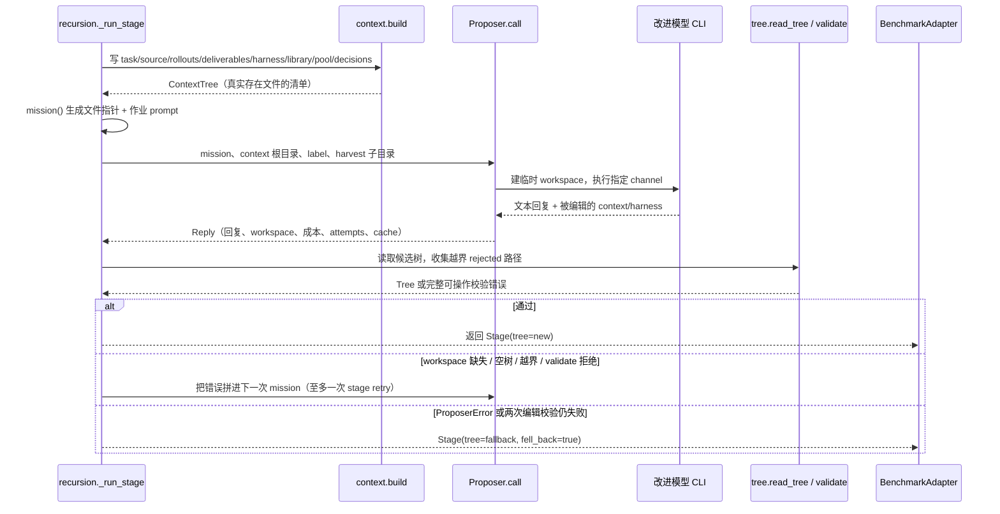

# 03 · 一个 Stage 如何运行：上下文、会话、回收与校验

[返回索引](README.md) · [递归算法](02-recursion-algorithms.md) · [证据边界](07-evidence-security.md)

## Stage 的准确含义

`Stage` 是一次“让改进模型基于证据修改 harness”的阶段记录，标签如 `inv1`、`dom1`、`agg1`、`c1`。它有输入维度、最终树、notes、错误、调用次数、缓存状态和成本。Stage 不等于 rollout：Stage 负责编辑/合成；它对应的 rollout 是随后由 benchmark adapter 发起的一次任务执行。

核心实现：`core/recursion.py::_run_stage`、`_accept_tree`、`_roll`；其辅助模块是 `core/context.py`、`core/proposer.py`、`core/tree.py`。

## 生命周期

## 第一步：context.build 写出证据文件

核心目录（实际缺文件时 mission 不宣称它存在）：

| 路径 | 从哪里来 | 用途 / 处理规则 |
|---|---|---|
| `context/task.md` | `adapter.task_prompt(task_id)` | 任务说明；具体 adapter 应剥离判分标准、期望答案 |
| `context/source/` | `adapter.task_files(task_id)` | 拷贝源材料；按 `BenchSpec.leak_globs` 排除匹配路径 |
| `context/rollouts/<label>.md` | `adapter.trajectory(run_dir, obs_trunc=...)` | 统一可读轨迹；每条 observation 可限长，但整条轨迹不按 prompt token 上限剪掉 |
| `context/deliverables/` | adapter 提供的 `deliverable_files/text/listing` | 默认使用 grader 同款 extractor 渲染；某些 benchmark 只给文件名，不给文件内容 |
| `context/harness/` | 复制本 stage 编辑对象 | proposer 实际编辑的候选工作树 |
| `context/library/` | 当前 domain 的 library 目录 | 提供早期经验与完整 harness 条目，只作证据 |
| `context/pool/<label>/` | 候选 harness、轨迹、交付物、unified diff | compose/select/reflection 阶段按需提供候选证据 |
| `context/decisions/<label>.md` | 前序 Stage notes/error | 让 compose/reflection 追溯为何保留/回退修改 |
| `MISSION.md` | `context.mission(tree, job=...)` | 短作业说明和上述文件布局索引，不塞进完整轨迹 |

`context.build` 先重建目标目录，再拷贝证据。adapter 的轨迹或交付物读取失败会变成记录内容/失败项；若传入 rollout 却一条轨迹都无法渲染，会抛错，因为 proposer 不应在空证据上改进。

## 第二步：proposer 启动一个改进会话

`Proposer.call(mission, context_dir, label, system, timeout, max_attempts, harvest)` 的主要处理：

1. 根据 label、mission、system、context 相对路径与文件字节计算内容指纹。
2. 若 `.audit` 中有相同调用的非空 response；并且这次要求 harvest 时也存在缓存 workspace，则返回 `cached=True`、成本 0 的 Reply。
3. 若未命中，创建临时 workspace，把证据/项目拷贝进去；prompt 从 stdin 传给 channel 子进程。
4. channel adapter 提取 final assistant text 和成本；超时、空回复、CLI 错误先由 `Proposer.call` 的 transport retry 处理。retry 用尽后抛 `ProposerError`，`_run_stage` 捕获后直接回退，不再启动第二个 stage-level edit retry。
5. 如果请求 harvest，只复制指定子目录（通常 `context/harness`）到临时目录销毁前的持久位置。候选其余文件不会被无差别回传。
6. 把 mission/system/response/meta 与 harvested workspace 写入审计目录（若配置了 audit_dir）。

`Reply.attempts` 是 transport 层调用尝试；`STAGE_ATTEMPTS=2` 是 stage 对“有 reply 但 workspace/树结构不合格”的最多编辑尝试次数。由于 `ProposerError` 分支会直接 break，二者不是简单相乘的固定总次数。缓存命中不等于改进逻辑再次运行。

## 第三步：候选树如何被接受

### 读树和路径白名单

`tree.read_tree(surface, workspace, rejected=...)` 仅读取由 surface 声明的组件文件。路径正规化并逐项匹配允许模式；越界路径写进 rejected 列表。只要有 rejected，stage 就把整次树提案视为不合格，提示模型修正，而不是悄悄部分接受。

### 自动触发与校验

`_accept_tree` 顺序执行：

1. `tree.autotrigger`：新加 skill 没被常驻文本点名时，尝试补触发提示；若超常驻预算则不能靠此修复。
2. 计算与 fallback tree 的 diff，判断 `kept_base`。
3. `tree.validate`：常驻文本限制、允许路径、skill 名称/description/触发、子代理 frontmatter、Python 编译、脚本引用、保留脚本、hooks JSON schema 等通用规则。
4. `adapter.validate_tree`：benchmark / substrate 的额外不变式。
5. `context.assert_tree_has_no_grader_verdicts`：对候选文件名和文本执行评分标记绊线检查。

任一验证失败返回错误原文，反馈给模型修改；两轮都失败时，该 stage 返回输入树作为 fallback，`fell_back=true`，且该失败仍会作为 stage 被记账。这样能让 sweep 继续，同时不把未经校验的文件树拿去执行。

候选和终版之间的 `tree.diff_summary` 使用路径集合比较 added/removed/modified，并计算 always-on 字符数差。`tree.diversity` 把每棵树的非空行编码成 `path:line` 集合，计算候选两两 line-Jaccard，再报告 distinct tree 数。它是“候选有没有塌缩”的诊断统计，不是性能分数，也不会决定采纳。

## 第四步：rollout 是另一条调用路径

`recursion._roll` 把 Tree 写到 `runs/.../harnesses/<label>/`，然后 `adapter.execute(task_id, harness_dir, run_id)`。adapter 选择 launcher 与 substrate，返回 run directory。递归器由 directory 与 `adapter.delivered` 产生 `RunView`，无论成功与否都记录一个 rollout label。

`RunView` 故意不包含 score。它主要含：`label`、`run_id`、`run_dir`、`ok`、`delivered`、`cost_usd`、`wall_s`、`error`。这让提案与 compose 的输入是行为/产物证据，不是判分结果。

## 这套分层解决什么问题

- 证据构建失败被归到 stage 边界，能以具体 label 和错误记录，而不是随机污染别的阶段。
- 模型负责提出编辑，不负责绕过本地校验；校验错误可以变成下一轮明确指令。
- 运行时产物由 benchmark adapter 解释，递归代码不猜目录结构。
- 每次会话可用输入、输出、成本和 fingerprint 复盘；目录字节变化会令缓存指纹变化。

## 易混淆的状态

| 状态 | 含义 |
|---|---|
| `fell_back` | 提案阶段失败/证据无法构建，Stage 使用其 fallback tree；不代表 rollout 执行失败 |
| `kept_base` | 候选树与本 stage 的 fallback 树 diff 为空；在 seq 中 fallback 是当前 checkpoint，未必是全局 base |
| `RunView.ok` | rollout 运行目录/执行状态可用 |
| `RunView.delivered` | benchmark 确认所需交付物存在 |
| `cached` | proposer 会话从审计缓存复用，不是 solver rollout 被跳过 |

继续阅读：[证据安全](07-evidence-security.md) · [执行适配器](05-adapters-substrates-channels.md) · [预算和缓存](06-state-budget-resume.md)
