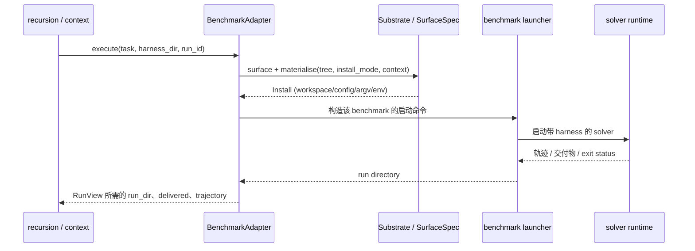

# 05 · Benchmark Adapter、Substrate 与模型 Channel

[返回索引](README.md) · [系统架构](01-architecture.md) · [Stage 生命周期](03-stage-context-proposer.md)

## 为什么需要拆成三部分

“要做什么任务”“agent harness 如何安装/运行”“改进模型如何调用”是三种不同问题。若把它们合并为一个 adapter，会导致每个新基准都复制模型调用与递归编排；若把所有 agent 框架写死在 core，又会让算法跟随 runtime 文件结构变化。

代码位置：接口在 `core/spec.py`，执行协议在 `substrate/base.py`，manifest 解析在 `substrate/manifest.py`，注册在 `substrate/registry.py`，基准实现位于 `benchmarks/`。

## 1. Benchmark：任务和评估语义

`BenchSpec` 是一组静态值，不是执行器：

- `name`, `runs_root`, `install_mode`
- `prompts` / `channels`
- `domain_word`, `leak_globs`, `allow_subagents`, `reserved_scripts`
- `proposer_deliverables`, `state_deliverable`, `obs_trunc`

具体 adapter 实现 `BenchmarkAdapter`：

| 方法 | 责任 |
|---|---|
| `tasks(split)` / `domain_of(task_id)` | 确定任务集合、稳定顺序和经验分组 |
| `task_prompt` / `task_files` | 提供去除评分答案后的任务及原始源材料 |
| `base_harness` / `validate_tree` | 返回本基准的起始 harness、附加候选约束 |
| `execute(task_id, harness_dir, run_id)` | 通过该基准 launcher 执行一次任务 |
| `trajectory` / `delivered` | 读取行为轨迹、判断任务交付 |
| `deliverable_files/text/listing/assets` | 将交付物按可审阅和可判分的方式提取 |
| `score` | 被独立 judge CLI 调用的后置判分接口 |

`RunView` 是 core 用于表达一次 rollout 的轻量结果，不含评分；具体原始日志由 adapter/run directory 保存。

### 仓库内的适配器类别

| 实现 | 主要特征 |
|---|---|
| `benchmarks/lab.py::LabAdapter` | LAB 任务发现、runtime launcher、交付物读取及 rubric scorer；支持的 substrate 在 `spec_for` 中决定 |
| `benchmarks/jobbench.py::JobBenchAdapter` | JobBench runner、任务执行目录、artifact/score extractor；OpenCode 与 Codex 有各自 launcher 路径 |
| `benchmarks/workbuddy.py::WbAdapter` | 通过 Harbor batch 管理 trials；按 task/run id 对 trial 排序、复用并读取产物 |
| `benchmarks/local.py::LocalAdapter` | 用户提供的本地 task 目录和完成检查脚本，适合 manifest substrate 或自定义实验 |

这些适配器的实现不能互换；尤其 WorkBuddy 的 Harbor trial、JobBench runner 和 local `check.sh` 具有不同执行/产物布局。

## 2. Substrate：agent harness 的运行适配

`Substrate` 关注 solver rollout 的可编辑面与启动方式。关键操作包括：

1. `surface()` 返回 `SurfaceSpec`：组件位置、always-on 文件及字符上限、skill/subagent/hook 路径规则。
2. `materialise(tree_dir, spec, ctx)` 把规范化的 harness tree 投影成该 runtime 能加载的文件/配置，返回 `Install`。
3. `execute(RunRequest, install)` 按 adapter 提供的 launcher 运行 solver，并返回 run 目录。
4. `read_trajectory` 将 OpenCode event stream、Codex thread items 或通用 JSONL/stdout 转成共享的 `[ACTION] / [OBSERVATION] / [ERROR]` 语法。
5. `preflight` 检查执行器和依赖是否可用。

| Substrate | 代码特点 |
|---|---|
| OpenCode | `substrate/opencode.py` 定义 OpenCode surface、合成提示模板、安装模式、argv/env 和事件流解析 |
| Codex | `substrate/codex.py` 投影 `AGENTS.md`、`.agents`、`.codex`，生成 exec 参数并渲染 thread-item stream |
| Generic manifest | `manifest.py` 将 JSON 声明解析为 `SubstrateManifest`；`GenericSubstrate` 按声明安装、启动和解析轨迹 |
| Host runner | `substrate/host.py` 在本地 workspace 写任务文件、启动 manifest CLI、快照输出 |

`registry.create(name)` 负责别名、内置 class 和 manifest substrate 发现。manifest 能减少接入代码，但不会替代 benchmark 的任务/产物语义；它定义的是 runtime surface、安装模板、执行参数和轨迹路径。

## 3. Channel：改进会话的调用设置

`ChannelSpec` 表示访问一个 proposer/selector 模型的方式，字段包括 `kind`、`model`、`effort`、`steps`、`timeout`。当前支持 `claude_cli`、`opencode`、`dsh_cli`、`hermes_cli`。

- `BenchSpec.channels` 至少有 `proposer` 与 `selector` 两种角色配置。
- `resolve_channel_model` 要求 channel 和 model 同时覆写；校验 OpenCode provider 前缀、Claude bare model id 等常见错配。
- `schedule._selector_for` 可在 selector 与 proposer 配置匹配时复用 proposer，否则创建独立 proposer。
- `Proposer` 负责的是会话进程、审计、缓存与 harvest，不负责运行 benchmark solver。

因此一个典型实验可以用 Claude/OpenCode channel 生成改动，而用另一个 substrate 运行任务。更换其中一项不代表另一项自动变化。

## 实际调用顺序

核心层通过 adapter 调用，不直接拼 `opencode run` 或 Harbor 命令。相同 substrate 可以被多个 benchmark adapter 使用；每个 adapter 仍需按基准的 runner 约定实现执行路径。

## 新接入时要实现什么

1. 若是新 benchmark：定义 `BenchSpec`、adapter 方法、任务流、source/leak globs、deliverable reader、validator、score；决定支持哪些现有 substrate。
2. 若是新 agent runtime：实现 substrate surface/install/exec/trajectory；或提供一份可验证的 manifest。
3. 若是新 proposer provider：实现 `Proposer` channel dispatch、model id 校验、输出/成本解析和审计行为。
4. 写明哪些部分共享、哪些为组合限制；不能只因两边各自存在就宣称组合已支持。

## 解决的问题和未解决的问题

- Protocol 降低了递归 core 对 benchmark/runtime 的耦合，方便 adapter 单独维护执行语义。
- `SurfaceSpec` 将 harness 可编辑路径变成代码可校验契约，减少路径约定散落。
- `ChannelSpec` 让 proposer/selector 的模型访问配置与 solver substrate 分离。
- Protocol 不是插件隔离或安全 sandbox。adapter、launcher 与 runtime 子进程仍能触及其 OS 权限可访问的资源。
- `execute_many` 是可选的批量优化；core 会在不存在该能力时退化为逐项执行。

继续阅读：[执行安全边界](07-evidence-security.md) · [CLI 使用](08-cli-runbook.md) · [仓库 SUBSTRATES.md](../../SUBSTRATES.md)
